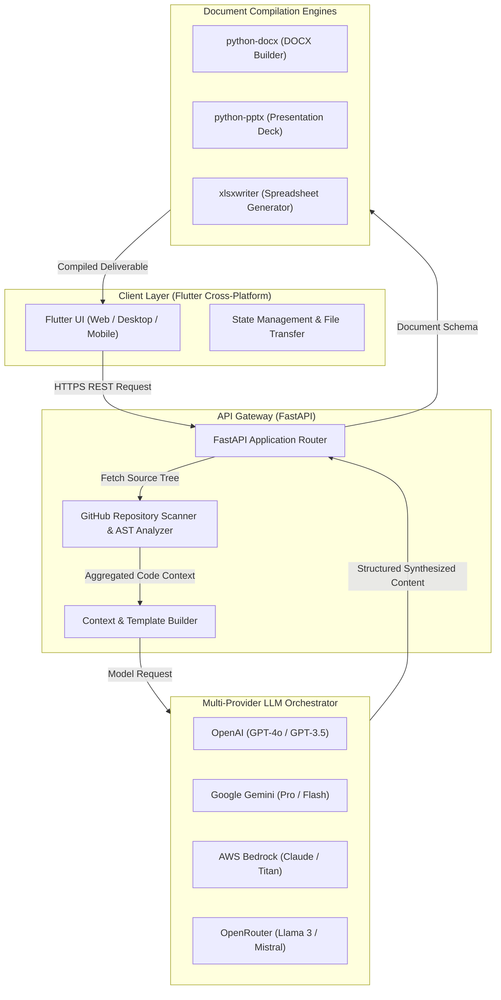

# ASTHRA: AI Document Generation and Analysis Ecosystem

<div align="center">

[](https://flutter.dev)
[](https://fastapi.tiangolo.com)
[](https://www.python.org/)
[](LICENSE)

**An intelligent document orchestration pipeline pairing cross-platform Flutter client with FastAPI and multi-provider LLM synthesis.**

</div>

---

## Architectural Overview

ASTHRA bridges multi-model AI synthesis with deterministic document assembly engines. The cross-platform Flutter frontend transmits structural prompts and repository links to the asynchronous FastAPI backend, which coordinates LLM reasoning and compiles output into Microsoft Office and PDF deliverables.



---

## Core Capabilities

- **Multi-Model LLM Orchestration**: Unified routing across OpenAI, Google Gemini, AWS Bedrock, and OpenRouter with automatic token context window calculation.
- **Automated Repository Documentation**: Scans remote GitHub repositories, parses file trees, extracts architectural patterns, and synthesizes technical specification manuals.
- **Native Office File Generation**: Directly compiles DOCX technical reports, PPTX presentation decks, and XLSX analytical datasets without third-party desktop dependencies.
- **Cross-Platform Interface**: Responsive Flutter application running natively on Android, iOS, Windows, macOS, Linux, and modern web browsers.

---

## Technology Stack

| Layer | Component | Description |
| :--- | :--- | :--- |
| **Frontend** | Flutter / Dart | Cross-platform UI, dynamic form rendering, and document viewer |
| **Backend API** | FastAPI / Python 3.11+ | Asynchronous REST endpoints and request orchestration |
| **AI Integration** | OpenAI, Google Gemini, AWS, OpenRouter | Multi-provider LLM prompt management and response streaming |
| **Document Processing** | python-docx, python-pptx, xlsxwriter | Document binary generation and template population |
| **Web Server** | Uvicorn | ASGI high-performance production server |

---

## Repository Structure

```
asthra/
├── android/                 # Native Android packaging
├── backend/                 # FastAPI backend service
│   ├── app.py               # Main application entry point and endpoints
│   ├── create_templates.py  # Office document template initializers
│   ├── requirements.txt     # Python runtime dependencies
│   └── templates/           # Document formatting templates
├── ios/                     # Native iOS packaging
├── lib/                     # Flutter frontend source
├── linux/                   # Native Linux packaging
├── macos/                   # Native macOS packaging
├── pubspec.yaml             # Flutter package manifest
├── web/                     # Web deployment assets
└── windows/                 # Native Windows packaging
```

---

## Local Development Setup

### 1. Backend Service

```bash
cd backend

# Create and activate a clean virtual environment
python3 -m venv venv
source venv/bin/activate  # On Windows: venv\Scripts\activate

# Install required packages
pip install -r requirements.txt

# Configure environment keys
export OPENAI_API_KEY="your-openai-key"
export GEMINI_API_KEY="your-gemini-key"

# Launch the FastAPI development server
uvicorn app:app --host 0.0.0.0 --port 8000 --reload
```

### 2. Frontend Application

```bash
# Ensure Flutter SDK is installed and available in PATH
flutter doctor

# Fetch Dart dependencies
flutter pub get

# Run on your target platform (chrome, macos, windows, android)
flutter run -d chrome
```

---

## API Endpoints Reference

| Method | Endpoint | Description |
| :--- | :--- | :--- |
| `POST` | `/generate/document` | Generates a DOCX technical report from user specifications |
| `POST` | `/generate/presentation` | Compiles a formatted PPTX slide deck with AI-generated sections |
| `POST` | `/analyze/github` | Clones or fetches repository trees and produces architecture summaries |
| `GET` | `/download/{file_id}` | Serves compiled document binaries |
| `GET` | `/health` | Health check endpoint returning runtime status |

---

## License

This project is licensed under the MIT License. See the [LICENSE](LICENSE) file for complete details.
